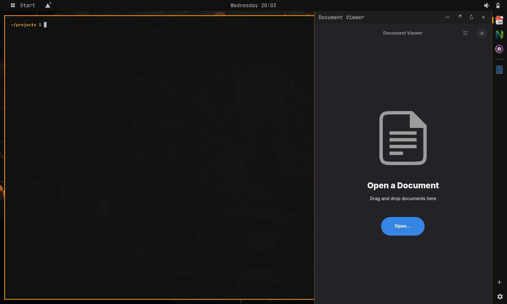
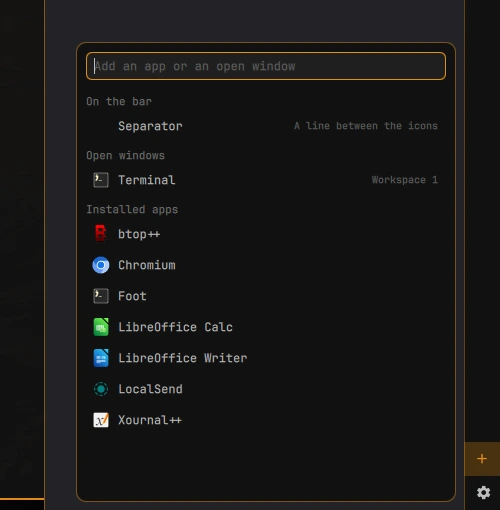
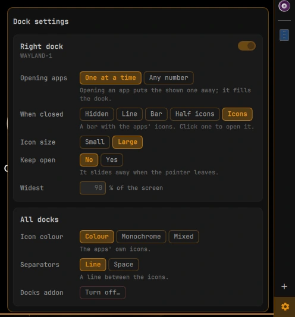

# omext docks

Part of [**omarchy-extended**](https://github.com/omarchy-extended): addons for [Omarchy](https://omarchy.org).

Docks on the left and right edges of your screens. Rest the pointer on an edge,
or click its bar, and the dock slides open with the apps you keep there. They
stay running while the dock is closed, and are back in place the next time it
opens.



- **One app at a time, or any number.** The open apps share the dock's height.
- **When closed**, a dock is hidden, a line, a bar, or a bar of its apps'
  icons. Unread counts show on the icons.
- **Add an app with +.** The plus at the foot of a dock's bar opens a small
  search: pick an installed app or an open window and it is in that dock. It
  stays there until you remove it, whether it is running or not.
- **Sort and remove by dragging.** Drag the icons on a bar to put them in
  order. While you drag, a bin shows at the bar's foot: drop an icon on it and
  the app is out of the dock.
- **Separators.** The + list also has a separator, to set apps apart on the
  bar: a line, or just a space (in the settings). It is dragged and removed
  like an icon.
- **An app's menu.** On its title bar, or with a right click on its icon:
  start on load, keep alive (started again if it closes), the dock's default
  app, and remove.
- **Titlebar buttons.** The titlebars Omarchy gives floating windows get ⇤ and
  ⇥ buttons, which send the window into the left or right dock. With
  [omext arrange](https://github.com/omarchy-extended/arrange) installed, its
  zone maps (the snap bar and the ▦ button) have the docks instead, beside the
  zones, and these buttons are left out.
- **Settings.** The gear under the + has that dock's settings, and what goes
  for every dock.
- **Escape** closes an open dock, unless a terminal in it has the keyboard.
- **On or off.** Omarchy menu › Setup › Omarchy Extended › Docks, or `omext-dock disable` / `enable`.

| Adding an app | The settings |
|---|---|
|  |  |

## Compatibility

Needs **Omarchy 4.5** or later (tested on 4.5.0): it builds on its floating
workspaces, titlebars and shell plugins.

Made for, and tested on, Omarchy's **floating** workspace layout:

```bash
omarchy hyprland workspace layout default floating
```

The other layouts, dwindle and scrolling, may work but are untested, and
nothing is guaranteed there.

## Install

You need Omarchy 4.5 or later, with `python` and `jq`.

```bash
git clone https://github.com/omarchy-extended/docks.git ~/.local/share/omext-docks
~/.local/share/omext-docks/install.sh
```

The install links the files from the clone, so `git pull` there updates it. It:

- links `omext-dock` into `~/.local/bin`;
- links the shell plugin `omext.docks` into `~/.config/omarchy/plugins`;
- installs the user service `omext-docks.service`, which keeps the docks' apps
  running;
- adds a marked block to `~/.config/hypr/hyprland.lua`, which loads `hypr/*.lua`;
- adds a Docks entry (Setup › Omarchy Extended) to `~/.config/omarchy/extensions/omarchy-menu.jsonc`;
- makes a first dock, on the right edge of the focused screen.

`./uninstall.sh` removes all of this. Your docks stay in
`~/.config/omext/docks.json`.

## Use

- Add a dock on another edge or screen: `omext-dock new left [--monitor NAME]`.
- Add an app: the + on the dock's bar, or a floating window's ⇤ ⇥ titlebar buttons.
- Everything else: an app's menu (its title bar, or a right click on its icon) and the settings.
- The full command list: `omext-dock --help`.

## Files

| Path | What it is |
|------|------------|
| `bin/omext-dock` | The command line and the watcher (`omext-dock watch`). |
| `plugins/omext.docks/` | The Omarchy shell plugin that draws the docks, the + list and the settings. |
| `hypr/*.lua` | Hyprland rules: docked windows, layers, titlebar buttons. |
| `systemd/omext-docks.service` | The watcher, as a user service. |
| `menu.jsonc` | The Omarchy menu entry. |
| `install.sh`, `uninstall.sh` | The standalone install. |
| `~/.config/omext/docks.json` | Your docks (`OMEXT_DOCKS_FILE` overrides it). |
| `~/.local/state/omext/docks/` | Runtime state. |

## License

MIT
